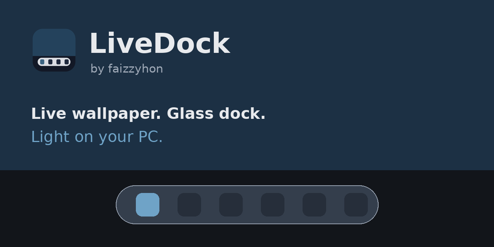

<p align="center"></p>

<h1 align="center">LiveDock</h1>
<p align="center"><b>Live wallpaper + transparent dock for Windows.</b><br>
Tiny. Light on RAM and CPU. Made for low-end PCs.</p>
<p align="center"><i>A side vibe-coded project by <a href="https://github.com/faizzyhon">faizzyhon</a></i></p>

---

## What is it for?

Windows has a boring taskbar and a still wallpaper. LiveDock changes both, without eating your PC:

- **Liquid glass dock** - a floating glass dock replaces the Windows taskbar. Drawn by LiveDock itself: light bends at the edge (lensing), a bright rim follows the shape, a soft shadow, and the tint adapts to your wallpaper. Icons grow with a spring when you move the mouse over them, and show their name.
- **Liquid window animation** - click an app in the dock and its window shrinks into the dock like liquid, or grows back out to its size.
- **Live wallpaper** - a calm built-in animation, or any GIF / image you add.
- **LiveDock Studio** - one window to pick your wallpaper, and to turn a video into a GIF wallpaper at the best quality a GIF can have.
- **Very low use** - one small `.exe` (about 320 KB), no runtime to install, low CPU priority, auto start with Windows.

## Use it

1. Download `LiveDock.exe` from [Releases](https://github.com/faizzyhon/LiveDock/releases) and run it.
2. The Windows taskbar hides and the dock appears. Auto start turns on.
3. Click the sliders tile at the end of the dock (or the tray icon) to open **LiveDock Studio**.

| Where | What it does |
|---|---|
| Studio > Wallpapers | Pick a wallpaper, add a GIF or image, open the wallpapers folder |
| Studio > Video to GIF | Choose or drop a video, pick quality, size, smoothness, length, then make the GIF. It becomes your wallpaper |
| Studio > About & Support | Links, and the PayPal support button |
| Right-click the dock / tray icon | Pin or unpin apps, glass blur on/off, window animations on/off, auto start, **Exit** (brings the Windows taskbar back) |

### Video to GIF (quality)
- **Quality:** Best makes a new colour set for every frame. This is the best a GIF can do, because GIF has only 256 colours per frame. Balanced and Light make smaller, lighter files.
- **Size:** Original (up to 4K), 1920, 1280 or 854 wide.
- **Smoothness:** 30, 24 or 15 fps. **Length:** 5 to 30 seconds.
- The first time, LiveDock downloads `ffmpeg` (about 90 MB) next to the exe. After that it works offline.
- Big GIFs use more RAM and CPU. On a slow PC, pick 1280 and Balanced or Light.

## Why it is light

- Native C++ (Win32 + GDI+), no .NET, no Electron, no browser engine
- Runs at below-normal priority, so your apps always win
- Wallpaper animation runs at 10 fps (a GIF uses its own speed)
- Wallpaper pauses and the dock hides when a game or fullscreen app is open
- The dock only redraws when something changes. The glass follows the wallpaper at about 5 fps. Turn off *Liquid glass* in the dock menu for even less use

## Brand

| | |
|---|---|
| Name | **LiveDock** by **faizzyhon** |
| Tagline | Live wallpaper. Glass dock. Light on your PC. |
| Colours | Ink `#12151A` - Slate `#1A1E25` - Mist `#E8EAED` - Tide `#6FA3C7` |
| Style | Calm, flat and quiet. No neon, no glow. |

## Build it yourself

```sh
sudo apt install mingw-w64     # Linux or WSL
./build.sh                     # makes LiveDock.exe
```

## Version

**1.1.0** - see [CHANGELOG.md](CHANGELOG.md).

## Honest notes

- This is a **side vibe-coded project** built with Claude. It works for me, but I have not tested every Windows version.
- Newest Windows 11 builds change how the desktop is built. If the wallpaper does not show, open an issue.
- The glass uses your own wallpaper as its backdrop. If a window sits behind the dock, the glass still shows the wallpaper.
- If the wallpaper does not show, right-click the dock and choose **Fix wallpaper (reconnect)**. Then look at `livedock.log` next to the exe and open an issue with it.
- The dock animation works when you click apps in the dock. Minimizing with the window's own button uses the normal Windows animation.
- The exe is not code-signed, so Windows SmartScreen may warn. Click "More info" then "Run anyway", or build it yourself.
- If it ever crashes and the taskbar stays hidden, restart `explorer.exe` (Task Manager) and it comes back.

## About me

**Muhammad Faizan (faizzyhon)** - Full Stack Developer and AI Engineer, Madinah, Saudi Arabia.

- GitHub: [github.com/faizzyhon](https://github.com/faizzyhon)
- Website: [faizzyhon.com](https://faizzyhon.com)
- Instagram: [instagram.com/faizzyhon](https://instagram.com/faizzyhon)
- Email: faizzyhon@gmail.com
- Support: [paypal.me/faizzyhon](https://paypal.me/faizzyhon)

If you like it, give the repo a star.

## License

MIT - see [LICENSE](LICENSE).
